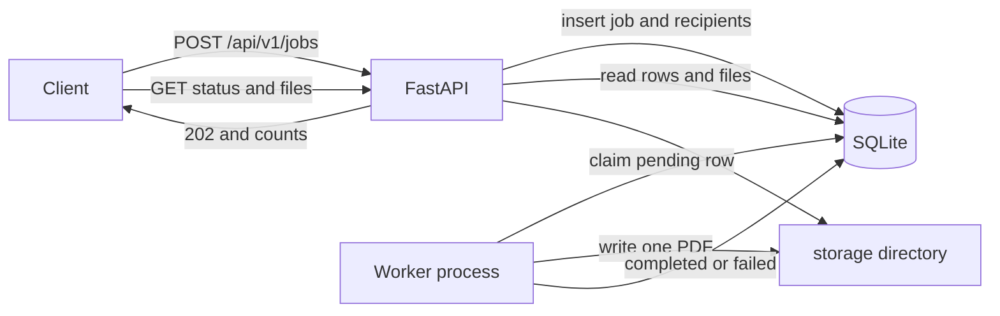

# Bulk Certificate Generator

Backend API that accepts one request containing many recipients and generates a certificate PDF for each valid person. Invalid recipients are recorded as failures and do not stop the rest of the batch. A separate worker process creates the PDFs, and clients poll for progress and download the finished files.

## Features

- Create a bulk job with `POST /api/v1/jobs` and receive `202 Accepted` immediately.
- Validate the job envelope and each recipient separately.
- Persist invalid recipients with the original input position and a clear error.
- Generate one landscape A4 certificate per valid recipient with ReportLab.
- Track job and recipient status in SQLite.
- Poll progress, list per-recipient results, download one PDF, or download a ZIP of the successful PDFs.
- Keep working when one recipient fails validation or PDF generation.
- Recover recipients left in `processing` after a worker crash, up to a small attempt limit.
- Health check that actually queries the database and checks the storage directory.

## Technology stack

| Piece | Choice |
| --- | --- |
| Language | Python 3.12+ (verified on 3.14) |
| API | FastAPI |
| Validation | Pydantic v2 |
| Database | SQLAlchemy 2.x with SQLite. `DATABASE_URL` can later point at PostgreSQL. |
| PDFs | ReportLab and the bundled DejaVu Sans font |
| Settings | pydantic-settings and environment variables |
| Tests | pytest and FastAPI's `TestClient` (built on HTTPX) |
| Lint and format | Ruff |

There is no Redis, Celery, message broker, or frontend. One API process and one worker process are enough to run the assignment locally.

## Architecture

The API writes the job and every recipient in one database transaction, then returns. It does not generate PDFs inside the request. A worker polls SQLite, claims one pending recipient at a time, writes that PDF outside the database transaction, and saves the result. The next recipient is processed even if this one fails.



Job counters are calculated from recipient rows whenever status is returned. The job row stores the same derived status so it can be queried, but it is not a second, hand-maintained counter.

## Project structure

```text
app/main.py                         Application factory, /health
app/config.py                       Environment settings
app/database.py                     Engine, sessions, SQLite pragmas
app/models.py                       CertificateJob and CertificateRecipient
app/schemas.py                      Request and response models
app/api/jobs.py                     Job create, status, results, ZIP
app/api/certificates.py             Single PDF download
app/services/validation.py          Job and per-recipient rules
app/services/job_service.py         Persistence, claiming, recovery
app/services/status.py              Status and progress rules
app/services/pdf_renderer.py        The one certificate layout
app/services/certificate_service.py File creation and ZIP assembly
app/services/storage.py             Safe paths and atomic writes
app/workers/certificate_worker.py   Polling worker
assets/fonts/                       DejaVu Sans and its license
examples/sample_request.json       Request used in the walkthrough
tests/                              Isolated API, PDF, and worker tests
```

## Setup

Python 3.12 or newer is required. Commands below assume the repository root is the current directory. The default SQLite file and storage directory are relative to that directory, so start the API and the worker from the same place.

### Windows PowerShell

```powershell
py -3 -m venv .venv
.\.venv\Scripts\Activate.ps1
pip install -r requirements.txt
copy .env.example .env
```

### macOS or Linux

```bash
python3 -m venv .venv
source .venv/bin/activate
pip install -r requirements.txt
cp .env.example .env
```

`.env` is optional. If it is missing, the defaults in `.env.example` are used. No passwords or cloud credentials are required.

### Database

Tables are created automatically when the API or the worker starts (`Base.metadata.create_all`). There is no separate migration step. SQLite enables foreign keys and WAL mode on each connection.

The default database file is `certificates.db` in the repository root. It is gitignored.

### Start the API

```powershell
uvicorn app.main:app --host 127.0.0.1 --port 8000
```

Interactive docs are then at <http://127.0.0.1:8000/docs>.

### Start the worker

In a second terminal, from the same directory and with the same environment:

```powershell
python -m app.workers.certificate_worker
```

Stop it with Ctrl+C. The worker finishes the certificate it has already claimed, then exits. Only one worker is supported. See [Limitations](#limitations).

## Configuration

| Variable | Default | Purpose |
| --- | --- | --- |
| `DATABASE_URL` | `sqlite:///./certificates.db` | SQLAlchemy URL |
| `STORAGE_DIR` | `./storage` | Directory for generated PDFs |
| `MAX_RECIPIENTS_PER_JOB` | `500` | Reject larger batches with 422 |
| `MAX_REQUEST_BYTES` | `1048576` | Reject larger bodies with 413 |
| `WORKER_POLL_INTERVAL_SECONDS` | `1` | Sleep when no recipient is pending |
| `PROCESSING_LEASE_SECONDS` | `300` | How long a claimed row may stay `processing` |
| `MAX_GENERATION_ATTEMPTS` | `3` | Crash retries before the recipient is failed |
| `LOG_LEVEL` | `INFO` | `DEBUG`, `INFO`, `WARNING`, `ERROR`, or `CRITICAL` |
| `MAX_NAME_LENGTH` | `200` | Recipient name limit |
| `MAX_EMAIL_LENGTH` | `254` | Email limit |
| `MAX_COURSE_NAME_LENGTH` | `200` | Course name limit |
| `MAX_ISSUED_BY_LENGTH` | `200` | Issuer limit |
| `CERTIFICATES_PAGE_SIZE_DEFAULT` | `100` | Default page size for results |
| `CERTIFICATES_PAGE_SIZE_MAX` | `500` | Largest accepted `limit` |

## API

All job and certificate routes are under `/api/v1`. Error bodies use `{"detail": ...}`. Request-validation errors use FastAPI's 422 list of `{loc, msg, type}`.

Unknown top-level fields and unknown recipient fields are ignored. Duplicate names are allowed. Duplicate email addresses are allowed: each submission gets its own recipient row and, if valid, its own PDF. Email addresses are stored after trimming, without lowercasing.

### `GET /health`

Checks that the process can run `SELECT 1` and that the storage directory exists.

```json
{"status": "ok", "database": "ok", "storage": "ok"}
```

If either check fails the response is `503` and `status` is `degraded`.

### `POST /api/v1/jobs`

Creates a job. Response status is `202 Accepted`.

```json
{
  "course_name": "Python Backend Development",
  "event_date": "2026-10-08",
  "issued_by": "Example Academy",
  "recipients": [
    {"name": "Aarav Sharma", "email": "aarav@example.com"},
    {"name": "Priya Patel", "email": "priya@example.com"},
    {"name": "", "email": "invalid-email"}
  ]
}
```

```json
{
  "job_id": "9f3b2a71-8c6e-45a3-b8e1-0c9543d2b111",
  "status": "pending",
  "course_name": "Python Backend Development",
  "event_date": "2026-10-08",
  "issued_by": "Example Academy",
  "total": 3,
  "pending": 2,
  "processing": 0,
  "completed": 0,
  "failed": 1,
  "progress_percent": 33.33,
  "created_at": "2026-10-08T09:30:00Z",
  "started_at": null,
  "completed_at": null
}
```

`progress_percent` includes recipients who have already failed validation:

```text
progress_percent = round(((completed + failed) / total) * 100, 2)
```

If `total` is somehow zero, progress is `0.0`. A normal request cannot create a job with zero recipients.

The whole request is rejected with **422** when:

- `recipients` is missing, not an array, or empty
- `course_name`, `event_date`, or `issued_by` is missing or the wrong JSON type
- the course name or issuer is blank or longer than its limit
- the event date is not a valid date
- the recipient count is above `MAX_RECIPIENTS_PER_JOB`

Those cases are not saved. A body larger than `MAX_REQUEST_BYTES` returns **413**.

A valid envelope with a bad recipient is saved. That recipient is `failed` immediately. The others stay `pending` for the worker. If every recipient fails validation, the job is already `failed`, `progress_percent` is `100.0`, and the response is still `202` because the job was accepted and stored.

### `GET /api/v1/jobs/{job_id}`

Returns the same shape as create. `404` if the job does not exist.

`status` is derived from recipient rows:

| Status | Meaning |
| --- | --- |
| `pending` | At least one recipient is still pending, and none have completed yet. Validation failures may already be present. |
| `processing` | A recipient is `processing`, or some recipients have completed while others are still pending. |
| `completed` | Every recipient completed. |
| `completed_with_errors` | At least one completed and at least one failed, and nothing is left pending or processing. |
| `failed` | Every recipient failed. |

This identity always holds:

```text
total = pending + processing + completed + failed
```

A job is not `completed` while any valid recipient is still pending, even if the worker is between rows and nothing is currently `processing`.

### `GET /api/v1/jobs/{job_id}/certificates`

Lists recipients in the original submission order.

Query parameters: `limit` (default 100, max 500) and `offset` (default 0).

```json
{
  "job_id": "9f3b2a71-8c6e-45a3-b8e1-0c9543d2b111",
  "total": 3,
  "limit": 100,
  "offset": 0,
  "items": [
    {
      "recipient_id": "c1d2e3f4-1111-2222-3333-444455556666",
      "input_index": 0,
      "name": "Aarav Sharma",
      "email": "aarav@example.com",
      "status": "completed",
      "error_message": null,
      "certificate_id": "c1d2e3f4-1111-2222-3333-444455556666",
      "download_url": "/api/v1/certificates/c1d2e3f4-1111-2222-3333-444455556666/download"
    },
    {
      "recipient_id": "aaaaaaaa-bbbb-cccc-dddd-eeeeeeeeeeee",
      "input_index": 2,
      "name": null,
      "email": "invalid-email",
      "status": "failed",
      "error_message": "Name is required; Email is not valid",
      "certificate_id": null,
      "download_url": null
    }
  ]
}
```

`certificate_id` is the recipient id. It is present only after a PDF has been generated. `404` if the job does not exist.

### `GET /api/v1/certificates/{certificate_id}/download`

Returns `application/pdf` and `Content-Disposition: attachment` for a completed certificate.

| Situation | Status |
| --- | --- |
| Unknown id | 404 `Certificate not found` |
| Pending, processing, or failed | 409 `Certificate is not available for download` |
| Row says completed but the file is missing or the stored path is unsafe | 404 `Certificate file not found` |
| Id is not a UUID | 422 |

The client never supplies a filesystem path. The id is a UUID, and the stored path is resolved and required to stay inside `STORAGE_DIR`.

### `GET /api/v1/jobs/{job_id}/download`

Returns a ZIP of completed PDFs only. Failed recipients are omitted. If the job does not exist, or no completed file is on disk, the response is `404`.

Archive entry names look like `0000_<recipient-uuid>_Aarav_Sharma.pdf`. The index and recipient id keep two people with the same name from overwriting each other. The ZIP is written to a temporary file and deleted after the response is sent, rather than being built as one large in-memory buffer.

## Job lifecycle

1. The API inserts the job and every recipient, then commits.
2. Invalid recipients are already `failed`. Valid ones are `pending`.
3. The worker claims the oldest pending recipient and sets `processing`. The job moves to `processing` and `started_at` is set.
4. The PDF is written to a temporary file in the job directory and renamed into place only after it exists and begins with `%PDF`.
5. The recipient becomes `completed` or `failed`. The job status is recalculated.
6. When every recipient is `completed` or `failed`, the job is terminal and `completed_at` is set.

Recipient flow for a valid person:

```text
pending -> processing -> completed
pending -> processing -> failed
```

An invalid person goes straight to `failed` during the request and is never claimed.

## Validation and failure handling

Job-level problems reject the request. Recipient-level problems are stored on that row.

Recipient rules:

- The item must be a JSON object.
- Name is required, must be a string, must not be only whitespace, and must be at most 200 characters.
- Leading and trailing whitespace is removed. Internal spaces are kept.
- Letters from any alphabet are accepted. Control characters are not.
- Email is required, trimmed, at most 254 characters, and must look like `name@example.com`. Internationalized domain names are not accepted.
- A name and an email can fail together. The messages are joined with `; `.
- Extra recipient fields are ignored.

Generation errors shown to the client are the fixed sentence `Certificate generation failed`. The exception and traceback stay in the server log. Logs include job and recipient ids, not names or email addresses.

If writing the completion row fails after a PDF was created, that file is removed and the row stays `processing` until the lease expires. A recipient that is marked failed, including one abandoned after too many crashes, also has `storage/<job_id>/<recipient_id>.pdf` removed so a failed row does not leave a certificate behind. Other recipients continue. A later worker pass retries the interrupted row.

## Certificate retrieval

Files are stored as:

```text
storage/<job_id>/<recipient_id>.pdf
```

Names are never used as paths. After the worker finishes, call the results endpoint, then either:

```text
GET /api/v1/certificates/{certificate_id}/download
```

or:

```text
GET /api/v1/jobs/{job_id}/download
```

The certificate itself contains the heading "CERTIFICATE OF COMPLETION", the recipient name, the course, the date in the form `8 October 2026`, the issuing organization, and the certificate id. The layout is landscape A4. Long names are wrapped and the font size is reduced so they stay on the page. Text is drawn as plain strings, so characters such as `<` cannot change the layout.

The bundled font is DejaVu Sans (see `assets/fonts/LICENSE`). It covers Latin, Greek, and Cyrillic. Chinese, Japanese, and Korean glyphs are not in that font.

## Testing

From the repository root, with the virtual environment active:

```powershell
pytest
ruff check .
ruff format --check .
```

Tests use a temporary SQLite file and a temporary storage directory per test. They do not read or write `./storage` or `certificates.db`. Coverage includes job creation, request validation, recipient validation, real PDF generation (including a 100-recipient batch), status and progress, isolated generation failure, downloads, ZIP contents, path traversal, crash recovery, and starting `python -m app.workers.certificate_worker` as a subprocess.

pytest may print one Starlette warning that `TestClient`'s current HTTPX integration is deprecated. That warning comes from the installed Starlette package. The tests pass.

## Design decisions

- **FastAPI** gives typed request validation, OpenAPI docs, and a small way to mount routes without a large framework. The behavior that matters lives in services, not in the framework.
- **SQLite** needs no server for local review and still exercises real SQL, foreign keys, and transactions. The URL is configuration, so PostgreSQL is a deployment change rather than a rewrite. The driver for PostgreSQL is not installed in this project.
- **ReportLab** draws a real PDF with no browser and no network access. One function owns the only template.
- **Background processing** keeps `POST` fast and lets one bad PDF fail alone. Doing the whole batch inside the request would hold the HTTP connection for the slowest file and would make a crash look like a failed request even after some files had been written.
- **A separate worker process** is used instead of a thread inside the API. It can be restarted on its own, and it does not share the API's request threads. It claims work from the database, so no Redis list is required.
- **Files live on disk** and the database stores a relative path. PDF bytes would bloat the database and make backups and downloads clumsier. The path is always `<job uuid>/<recipient uuid>.pdf`.
- **Failures are isolated** by a `try` around each recipient. Validation failures are rows, not request errors. Generation failures update that row and the loop continues.
- **Progress** is `(completed + failed) / total`. A validation failure is already finished work. Success-only progress would stay below 100% for a finished job that had bad rows.

## Limitations

- One worker is the supported mode. The claim is a conditional `UPDATE ... WHERE status = 'pending'`, so two processes cannot both complete the same row, but SQLite is not a multi-worker queue and that setup was not load-tested.
- A recipient left in `processing` is retried after `PROCESSING_LEASE_SECONDS`, at most `MAX_GENERATION_ATTEMPTS` times. There is no general retry library and no automatic retry of a generation error that was caught and saved as `failed`.
- There is no authentication, authorization, rate limiting, virus scanning, or retention job. Anyone who can reach the API can create jobs and download PDFs if they know the ids.
- The DejaVu font does not cover CJK characters. Those names still produce a PDF, but missing glyphs may render as boxes.
- Email checking is a practical ASCII pattern, not the full RFC and not IDN.
- `create_all` updates nothing when columns change. A real deployment needs migrations.
- Status responses trust the recipient table. The stored job status is updated in the same transaction, but clients should treat the returned counts as the source of truth.

## Production improvements that are not implemented

- Run PostgreSQL by installing a driver such as `psycopg` and setting `DATABASE_URL`.
- Move claiming to a durable queue such as Celery and Redis, or to `SELECT ... FOR UPDATE SKIP LOCKED` on PostgreSQL, if more than one worker is required.
- Add authentication, authorization, and rate limits before exposing the API.
- Store PDFs in object storage and keep only the object key in the database.
- Add a public verification endpoint for a certificate id.
- Add metrics, structured logging, and alerts around queue age and failure rate.
- Delete old jobs and files on a retention schedule.

## Example workflow

Use two terminals from the repository root. The sample file contains two valid recipients and one invalid one.

Terminal 1:

```powershell
uvicorn app.main:app --host 127.0.0.1 --port 8000
```

Terminal 2:

```powershell
python -m app.workers.certificate_worker
```

Terminal 3:

```powershell
curl.exe -s -X POST http://127.0.0.1:8000/api/v1/jobs -H "Content-Type: application/json" --data-binary "@examples/sample_request.json"
```

Copy `job_id` from the response, then poll:

```powershell
curl.exe -s http://127.0.0.1:8000/api/v1/jobs/<job_id>
```

When `status` is `completed_with_errors` and `progress_percent` is `100.0`, list results:

```powershell
curl.exe -s http://127.0.0.1:8000/api/v1/jobs/<job_id>/certificates
```

The invalid row has `status` `failed` and no `download_url`. For a completed row:

```powershell
curl.exe -s -D - -o certificate.pdf http://127.0.0.1:8000/api/v1/certificates/<certificate_id>/download
```

Or download every successful PDF:

```powershell
curl.exe -s -o certificates.zip http://127.0.0.1:8000/api/v1/jobs/<job_id>/download
```

On macOS or Linux, `curl` can replace `curl.exe`.
